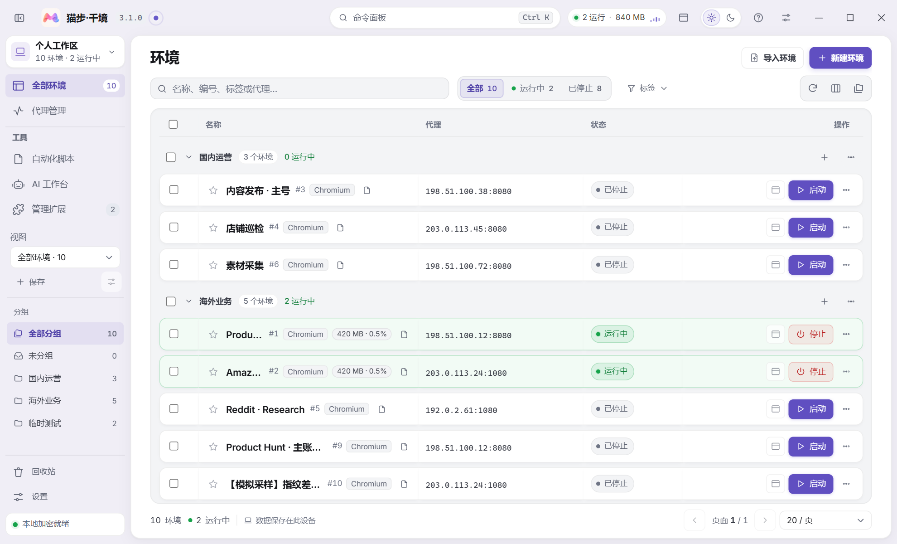
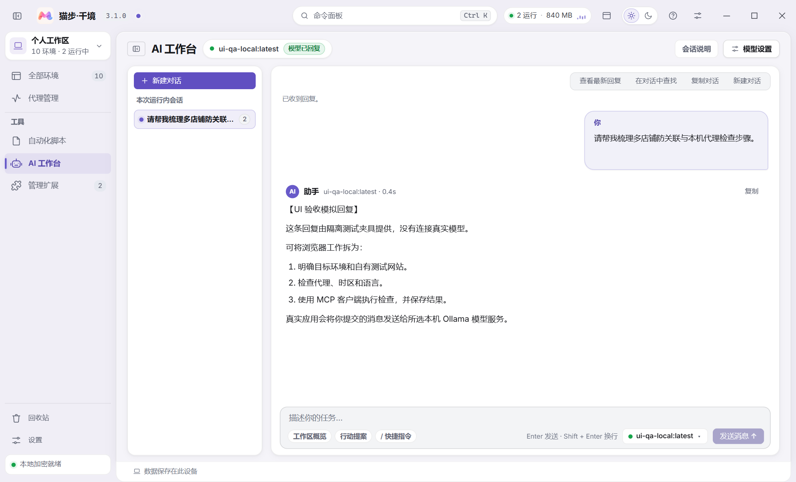
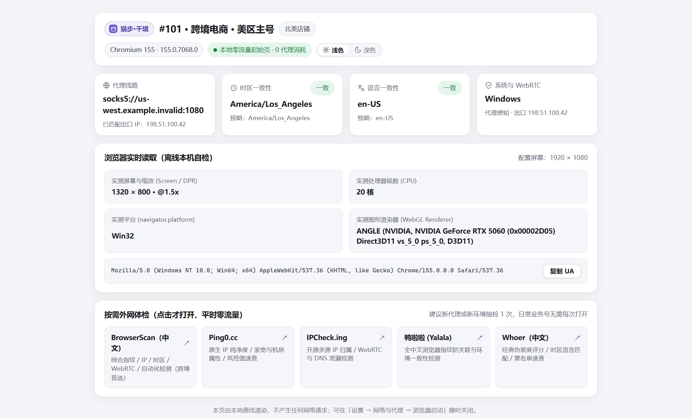
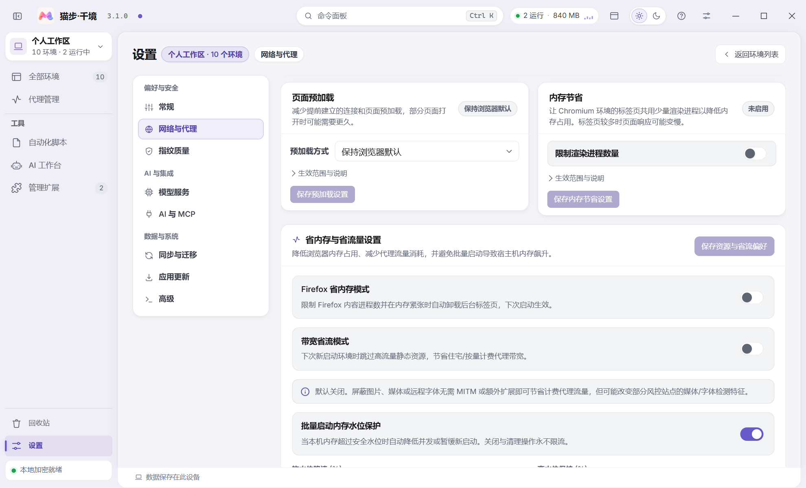
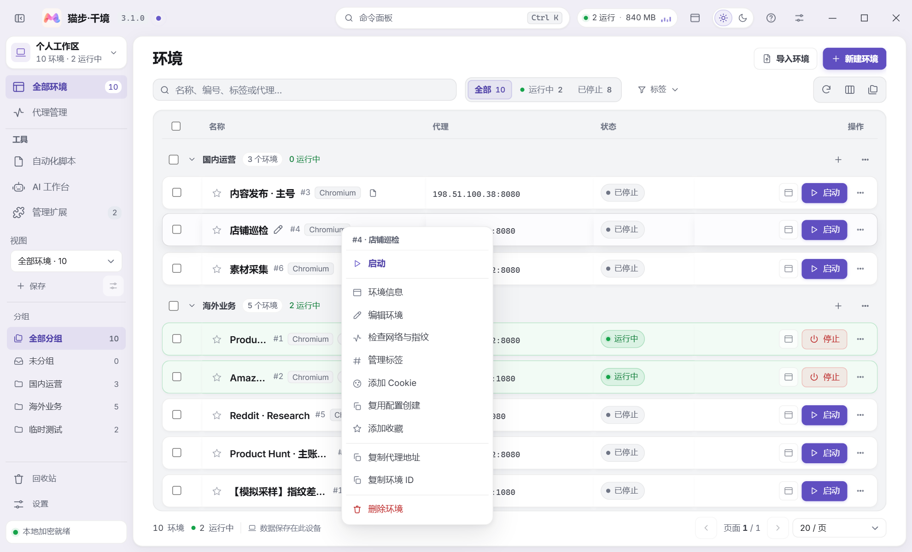

<div align="center">


<h1>猫步·千境 · 本地版</h1>

<p><strong>纯本地、零云端依赖的 Windows 指纹浏览器桌面工作台（基于 Tauri 2 + Bun + React）</strong></p>

[](https://github.com/maobukeai/maobu-qianjing/releases/latest)


<p>
  <a href="https://github.com/maobukeai/maobu-qianjing/releases/latest">下载最新版</a> ·
  <a href="#界面预览">界面预览</a> ·
  <a href="#核心特性">核心特性</a> ·
  <a href="#快速上手">快速上手</a> ·
  <a href="#本地自动化与-mcp">本地自动化</a> ·
  <a href="#从源码构建">从源码构建</a>
</p>

<picture>
  <source media="(prefers-color-scheme: dark)" srcset="docs/assets/screenshots/workbench-dark.png" />
  <source media="(prefers-color-scheme: light)" srcset="docs/assets/screenshots/workbench-light.png" />
  
</picture>

</div>

当前源码与官方签名发行版为 [`v3.1.0`](https://github.com/maobukeai/maobu-qianjing/releases/latest)，提供 Windows x64 安装包（NSIS）与内置 Ed25519 信任根的签名自动更新。打开即可在本机离线管理多开浏览器环境，无需注册账号，所有配置、Cookie、会话、脚本与备份均留存在本地设备，参见 [发布签名说明](docs/release-signing.md) 与 [开发迭代记录](docs/iterations/2026-11-09-eight-hour.md)。

## 界面预览

> 主界面随 GitHub 外观自动切换浅色 / 深色截图，下方展示重点场景功能界面（均为隔离演示数据）：

<table>
  <tr>
    <td width="50%" align="center">
      
      <br />
      <strong>AI 工作台 · Markdown 富文本与内联模型切换</strong>
    </td>
    <td width="50%" align="center">
      
      <br />
      <strong>零流量启动页 · 实时指纹自检与中文检测入口</strong>
    </td>
  </tr>
  <tr>
    <td width="50%" align="center">
      
      <br />
      <strong>网络与性能策略 · 预加载 / 内存节省与代理前检</strong>
    </td>
    <td width="50%" align="center">
      
      <br />
      <strong>智能右键菜单 · 按环境行、多选与工作区上下文切换</strong>
    </td>
  </tr>
</table>

## 核心特性

### 1. 多内核指纹隔离与零流量启动页
- **多引擎按需管理**：Windows 默认使用 `Chromium 155`，并支持按环境切换 `Firefox 156` 与 `CloakBrowser`；内核与字体包均固定源码版本与 `SHA-256` 校验，仅在首次启动对应环境时按需下载缓存，打开管理界面不触发任何下载。
- **独立指纹与模板预设**：每个环境拥有独立存储目录、Cookie、本地会话与自定义 2FA TOTP 验证器；支持保存最多 `100` 套环境配置预设模板（应用前预览浏览器、内核、操作系统、屏幕与平台 5 项差异，不覆盖已有名称、代理与账号凭据）。
- **指纹质量审计与证据对照**：支持对已配置身份与运行中浏览器的实测指纹（CPU 核心数上限、系统、语言、屏幕、时区、WebGL / Canvas / Audio）进行同页比对与显式重采样；可筛选警告/异常项，并一键生成匿名诊断摘要交由 AI 工作台辅助分析。
- **本地零流量启动页**：环境启动时默认打开本地离线渲染页（可在「设置 → 网络与代理 → 浏览器启动」随时开关），支持浅色/深色主题切换、代理线路与时区/语言一致性实时自检，以及按需点击的中文友好体检入口（BrowserScan、Ping0.cc、IPCheck.ing、鸭啦啦、Whoer），日常零后台流量。

### 2. 高效桌面工作台与多开协同
- **轻盈桌面交互**：`192px` 紧凑可折叠侧栏、浅色 / 深色 / 跟随系统三态外观；列表支持**舒适 / 标准 / 紧凑**三档行高密度与千行级虚拟滚动；内置分组、收藏夹、多标签 `OR / AND` 组合筛选、自定义保存视图、行内备注/编号快速编辑与环境活动时间线。
- **智能右键菜单与全局命令面板**：替换原生网页右键菜单，可根据当前点击位置（多选环境、单环境行、分组、列表空白区或工作区）动态切换快捷菜单（保留文本选区、输入框与 `Shift + 右键` 原生透传）；支持 `Ctrl / ⌘ + K` 打开命令面板直达任意页面与环境操作。
- **默认浏览器注册与外链分流**：支持在 Windows 中注册为默认浏览器，自动拦截外部应用或链接传入的 `HTTP / HTTPS` URL，按预设域名规则直达指定环境或弹出选择器决定打开目标。
- **窗口同步与系统资源优化**：支持设置主控/从属浏览器窗口，一键同步鼠标点击、滚轮与键盘输入（内置随机偏移抖动与 `Ctrl+Shift+F12` 紧急停止热键）；提供实时内存/CPU 监控、批量启动内存水位保护、单环境缓存清理、Firefox 省内存模式、Chromium 页面预加载与内存节省以及带宽省流模式。

### 3. 代理资产库与网络诊断
- **加密代理资产库（Proxy Vault）**：统一管理 `HTTP / HTTPS / SOCKS5` 代理线路（凭据静态加密存储），支持文本与 CSV 批量导入预览、单环境绑定与轮询（Round-Robin）分配，以及同平台重复绑定 / 同出口 IP 风险检测。
- **桌面代理发现与启动前检查**：一键扫描 `IPv4 (127.0.0.1)` / `IPv6 (::1)` 常见端口或自定义端口（适配 Clash、Mihomo、v2rayN 等桌面客户端），区分监听状态、SOCKS5 握手与真实出口位置校验；可选开启「本机代理启动前检查」，在 `800ms` 内核启动前探测回环端口可用性，避免无效启动。

### 4. 本地 AI 工作台与 RPA 自动化
- **多模型连接与隐私守护**：原生支持本机 **Ollama**，以及 **OpenAI 兼容 API**、**Anthropic**、**Gemini** 等远端服务；内置 Markdown 代码高亮、斜杠快捷指令、输入框内联模型切换器与默认模型记忆，API 密钥仅保留在内存会话中。默认仅发送用户对话，可选开启「包含匿名工作区概览」（仅计数）或「受控行动提案」（模型生成的环境操作必须经人工预览确认，绝不自动运行或泄露凭据）。详细配置见 [AI 工作台使用说明](docs/local-ai.md)。
- **本地脚本库与 RPA Studio**：支持 JavaScript / Python 自动化脚本管理、可视化动作录制、4 套离线模板、在线源码编辑、FIFO 串行队列执行以及异常截图回执（Node / Python 依赖均按需准备）。

### 5. 安全保护、多工作区与便携迁移
- **应用锁与脱敏诊断**：支持本地应用主密码锁锁定桌面工作台；支持创建多个完全隔离的数据工作区并自定义图标；内置 6 项一键只读系统诊断并支持导出脱敏报告（JSON / ZIP）。
- **三种便携备份与跨机迁移方式**：

| 方式 | 适用场景与包含范围 |
| --- | --- |
| **单环境便携包 `.mqprofile`** | 快速分享或跨机导入单个/批量的环境配置、账号资料与便携会话。 |
| **加密文件夹快照 `.mqsync`** | 配合 OneDrive、Syncthing、NAS 等第三方同步目录迁移；使用 `AES-256-GCM + scrypt` 加密环境配置、账户与便携会话，导入前先预览冲突并默认跳过现有/运行中环境。 |
| **完整工作区备份 `.mqbackup`** | 完整导出与恢复工作区数据库、浏览器存储、扩展安装目录、脚本库、应用偏好与模型连接配置；支持最高 `20 GB` 文件导入恢复（不含可重新按需下载的浏览器内核与已清除的 API 密钥）。 |

## 快速上手

### 方式一：直接下载安装包（推荐）
1. 前往 [GitHub Releases](https://github.com/maobukeai/maobu-qianjing/releases/latest) 下载最新签名版安装包 **`MaobuBrowser_3.1.0_x64-setup.exe`** 并完成安装。
2. 首次打开后，可在左上角 **个人工作区** 切换或新建工作区，在 **代理管理** 导入代理或在 **设置 → 网络与代理** 扫描本地桌面代理端口。
3. 点击右上角 **+ 新建环境** 创建测试环境，首次点击 **启动** 时将自动按需下载并校验 `Chromium 155` 内核。
4. 启动后可在本地零流量启动页直观查看指纹对齐状态，或通过 **设置 → 应用更新** 一键检查并安全安装后续签名更新。

### 方式二：运行本地调试版
已完成本地编译后，直接在项目根目录双击 **`启动猫步千境.cmd`**（旧入口 **`启动猫步浏览器.cmd`** 同步兼容），或执行：

```powershell
node scripts/run-local-desktop.mjs
```

- 桌面版独立数据目录默认位于 `%APPDATA%\com.maobu.local`（如需自定义英文调试运行根目录，可设置环境变量 `MAOBU_RUNTIME_DIR`）。

## 本地自动化与 MCP

### AdsPower 兼容本地 API
- 桌面版默认关闭兼容 HTTP API 以保障本地安全。需要接入现有自动化脚本时，可在启动桌面应用前设置 `MAOBU_DESKTOP_AUTOMATION_TOKEN`（64 位小写十六进制随机令牌）。
- 服务监听 `http://127.0.0.1:50400`，请求时附带 `Authorization: Bearer <令牌>`；详细端点规范见 [Local API 文档](docs/public/local-api.openapi.json)。

### 本地 stdio MCP Server
- 客户端通过标准输入输出启动内置的 `aliasmode-mcp.exe`，可运行以下命令获取当前英文运行目录与可执行路径：

```powershell
node scripts/run-local-desktop.mjs --prepare-only --json
```

- 将输出 `runtimeRoot` 下的 `aliasmode-mcp.exe` 配置为 MCP 命令，在 **设置 → AI 与 MCP** 可直接生成客户端配置并按需验证握手：
  - `serve --scope read-only`：默认只读权限（环境清单、指纹报告、本机代理发现）
  - `serve --scope profiles`：开放环境读写与配置操作
  - `serve --scope browser`：开放浏览器启动/关闭控制
  - `serve --scope full`：同时开放环境管理与浏览器控制
- 完整工具权限清单见 [MCP 工具目录](docs/public/mcp-tools/current-source.json)。

## 从源码构建

### 构建环境要求（Windows x64）
- **Bun** `1.3.13`
- **Node.js** `22+`
- **Rust** MSVC 工具链（`1.89+`）与 **Visual Studio C++ Build Tools**
- **Microsoft Edge WebView2 Runtime**（Windows 10/11 通常已预装）

### 常用开发与构建命令

```powershell
# 1. 安装依赖与类型检查
bun install --frozen-lockfile
bun run typecheck

# 2. 编译 Sidecar 与 Tauri 桌面应用（调试运行）
bun run desktop:prepare
cargo build --locked --manifest-path src-tauri/Cargo.toml
node scripts/run-local-desktop.mjs

# 3. 打包本地未签名 NSIS 安装包
bun run desktop:build:nsis
```

若仅调试本地网页后端与前端界面（默认监听 `http://127.0.0.1:50400`，状态目录与桌面版隔离）：

```powershell
bun src/cli.ts setup --state-root node_modules/.cache/local-dev
bun src/cli.ts start --state-root node_modules/.cache/local-dev
```

运行项目完整验证套件：

```powershell
bun test --timeout 10000
cargo test --locked --manifest-path src-tauri/Cargo.toml
bun run docs:public:check
bun run i18n:locales:check
```

> 可选离线打包参数：构建者如需内置离线 Firefox 运行时，可设置 `MAOBU_BUNDLE_FIREFOX=1` 及对应 `ALIASMODE_FIREFOX_ARCHIVE`、`ALIASMODE_FIREFOX_ARCHIVE_SHA256`、`ALIASMODE_FIREFOX_EXECUTABLE_SHA256` 校验信息。

## 目录结构与相关文档

```text
├── src-tauri/          # Tauri 2 原生桌面宿主（Win32 窗口同步、默认浏览器、应用更新与权限隔离）
├── src/                # 模块化后端域逻辑（代理资产库、指标监控、本地启动页、路由与存储）
├── web/                # React + TypeScript 前端工作台与三语本地化资源（zh-CN / en-US / ru-RU）
├── tests/              # 全量单元测试与集成测试集
├── test-fixtures/      # 隔离 DOM 夹具与真实浏览器内核验收指南
├── scripts/            # 桌面打包、签名验证与 UI 回归脚本
├── docs/               # 技术文档、公开契约与界面截图资产
└── agent/              # 本地控制与 stdio MCP 适配层
```

- [AI 工作台使用说明](docs/local-ai.md)
- [发布签名说明](docs/release-signing.md)
- [内核验收说明](test-fixtures/ENGINE-QA.md)
- [开发迭代记录](docs/iterations/2026-11-09-eight-hour.md)
- [Local API 契约](docs/public/local-api.openapi.json) · [MCP 工具目录](docs/public/mcp-tools/current-source.json)

## 隐私与联网边界

- **本地数据保护**：所有环境、代理、分组、脚本、Cookie 与便携备份均保存在用户本机。部分业务表包含登录凭据与 Cookie 等敏感资料，请妥善保护系统账户、数据目录以及加密备份密码（应用不保存备份与快照密码，遗失无法恢复）。
- **按需联网边界**：除用户自己打开的网页、搜索引擎、按需下载校验的浏览器引擎与运行时依赖（Node/Python/扩展）、主动触发的代理出口/IP 校验、用户明确选择的 AI 模型端点以及设置的 GitHub Releases 检查/签名更新通道外，软件本身不连接任何开发者中心账号或远程遥测服务器。

## 许可证与来源

本项目遵循 Apache-2.0 开源协议，保留 [LICENSE](LICENSE) 与 [NOTICE](NOTICE) 中的许可证及原作者署名（原始桌面应用基于 AliasMode / Xreacher 改造；各浏览器引擎与第三方组件遵循其各自开源许可证）。贡献与安全披露说明参见 [CONTRIBUTING.md](CONTRIBUTING.md) 与 [SECURITY.md](SECURITY.md)。
